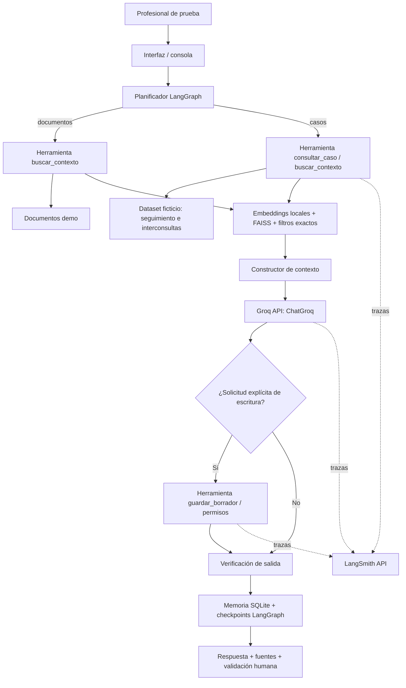

# EP2 ISY0101 — Agente INGER con Groq, LangGraph, RAG y LangSmith

**Evaluación Parcial 2: Desarrollo de un Agente Funcional.** Continuación del caso INGER de la Evaluación 1. Trabajo de demostración académica sobre **datos completamente ficticios** de seguimiento geriátrico, interconsultas y traslados. No es un sistema clínico, no sustituye decisiones profesionales y no incorpora información identificable de pacientes.

## 1. Entregables

- `app.py`: interfaz por consola para realizar consultas o ejecutar escenarios.
- `inger_agent/grafo.py`: grafo funcional LangGraph que coordina herramientas, rutas adaptativas, Groq, memoria y verificación.
- `inger_agent/core.py`: estructuras, planificación, reglas simuladas y autorización de escritura.
- `inger_agent/recuperacion.py`: recuperación híbrida por ID exacto + embeddings semánticos locales y FAISS.
- `inger_agent/memoria.py`: memoria persistente por hilo y almacenamiento de borradores en SQLite.
- `inger_agent/prompts.py`: prompts del caso EA1 convertidos en instrucciones operativas.
- `data/`: casos, reglas y procedimientos **ficticios**.
- `tests/`: pruebas unitarias sin API.
- `notebooks/EP2_INGER_Groq_LangSmith.ipynb`: notebook para Google Colab.
- `docs/`: diagrama de orquestación, matriz de pruebas y guion de video.

## 2. Preparación local

**Requisitos:** Python 3.11–3.12 preferentemente, conexión a Internet (solo para instalar dependencias, descargar el modelo de embeddings y llamar a las API). Recomendado Google Colab por la instalación de FAISS y `sentence-transformers`.

```bash
python -m venv .venv
# Windows PowerShell: .venv\Scripts\Activate.ps1
# Linux/macOS: source .venv/bin/activate
python -m pip install -r requirements.txt
```

Cree claves desde [Groq Console](https://console.groq.com/keys) y [LangSmith](https://smith.langchain.com/). Configure las variables **en su entorno privado**, nunca en archivos para GitHub:

```powershell
# PowerShell
$env:GROQ_API_KEY="SU_CLAVE_GROQ"
$env:LANGSMITH_API_KEY="SU_CLAVE_LANGSMITH"
$env:LANGSMITH_TRACING="true"
$env:LANGSMITH_PROJECT="INGER-EP2-GROQ-DEMO"
$env:GROQ_MODEL="openai/gpt-oss-20b"
$env:LANGGRAPH_STRICT_MSGPACK="true"
```

El modelo por defecto es `openai/gpt-oss-20b`. No usar el antiguo `llama-3.3-70b-versatile` en planes de desarrollo: Groq anunció su retiro en agosto de 2026. Groq **genera texto**, mientras que los embeddings se calculan localmente con `sentence-transformers/paraphrase-multilingual-MiniLM-L12-v2`; FAISS recupera contexto semántico.

**Ejecutar la demostración real con las dos API:**

```bash
python app.py --modo groq --hilo equipo-ep2 --rol gestor_demo --escenarios
```

**Probar una pregunta específica:**

```bash
python app.py --modo groq --hilo equipo-ep2 --rol lector_demo --pregunta "¿Qué pendientes tiene CASO-001?"
```

**Verificar las pruebas sin credenciales, sin API y sin LangGraph:**

```bash
python -m unittest discover -s tests -v
python app.py --modo offline --hilo verificacion --rol gestor_demo --escenarios
```

El modo `offline` únicamente prueba la lógica local y utiliza coincidencias de palabras; **no equivale a verificar Groq, FAISS ni LangSmith**. Para probar el grafo LangGraph sin Groq se puede instalar el entorno completo y ejecutar `--modo demo`; ese modo crea checkpoints, usa herramientas tipadas y guarda memoria, pero no llama a Groq. El modo `groq` realiza la integración real y es el **único modo válido para filmar la demostración de Groq + LangSmith**.

## 3. Ejecución en Google Colab

Abra `notebooks/EP2_INGER_Groq_LangSmith.ipynb`. El primer bloque pide subir el ZIP del proyecto, lo extrae y cambia el directorio de trabajo; el segundo instala dependencias; el tercero obtiene claves de `Secrets` en Colab o, como alternativa, solicita ingreso oculto. Nunca imprima las claves ni deje el panel de secretos visible en el video. Ejecute después los escenarios con `modo="groq"`, observe los planes, las fuentes, la escritura del borrador y compruebe las trazas en [LangSmith](https://smith.langchain.com/).

## 4. Arquitectura de funcionamiento



**Herramientas efectivas (con Pydantic):**

1. `consultar_caso`: lectura exacta de dos registros sintéticos por ID.
2. `buscar_contexto`: recuperación FAISS y filtros de caso o tipo de documento.
3. `evaluar_reglas`: evaluación administrativa determinista de R1, R2 y R3, **simuladas**.
4. `guardar_borrador`: escritura persistente y controlada; exige rol `gestor_demo` y solicitud explícita. No escribe en Excel ni fichas.

**Memoria de corto plazo:** `SqliteSaver` conserva estado e historial conversacional por `thread_id`, incluso entre ejecuciones usando el mismo archivo de checkpoints. **Memoria de largo plazo:** tabla `memoria` en SQLite; consulta por hilo y reordenamiento semántico con el mismo modelo de embeddings. **Escritura controlada:** tabla `borradores` con una clave de idempotencia, separada de todas las fuentes originales.

**Decisión adaptativa:** el planificador selecciona entre síntesis, pendientes, priorización administrativa, consulta de documentos y escritura. Si el caso solicitado no existe, el agente se abstiene. Si se intenta escribir sin permisos, lo deniega; con permisos y una orden explícita, guarda un borrador. En cada paso el grafo decide la siguiente ruta según intención.

## 5. Seguridad

- **NO cargar datos reales** del INGER ni datos personales de pacientes en Groq, LangSmith o el repositorio.
- Las hojas reales recibidas se usaron **solo para comprender la estructura de campos**, no se incluyen en este proyecto.
- Los documentos y reglas están marcados explícitamente como **ficticios**.
- Si LangSmith está activo, recibe las entradas/salidas del grafo: usar solo información simulada.
- El identificador `CASO-001` no equivale a RUT ni al identificador de una persona real.
- Los borradores no modifican fuentes y requieren rol autorizado; los controles de rol de esta demostración no sustituyen un sistema de autenticación institucional.
- No se realizan diagnósticos, tratamientos ni priorización clínica.

## 6. Pruebas y evidencia

Pruebas unitarias: `python -m unittest discover -s tests -v`. Se verifican rutas, reglas, diferencia entre pendiente y sin registro, aislamiento de consulta por caso, memoria persistente, control de escritura, idempotencia y flujo multiturno. No se incluyen capturas falsas de Groq o LangSmith: las capturas deberán obtenerse durante una ejecución autenticada real.

**Para el video:** ejecutar los cinco escenarios de `--escenarios`, abrir LangSmith y mostrar el proyecto `INGER-EP2-GROQ-DEMO` con una traza que incluya el grafo, pasos de consulta, invocación del LLM y tiempos. Use `docs/guion_video.md`.

## 7. Rúbrica EP2 y referencias

IE1 herramientas autónomas; IE2 frameworks; IE3 memoria; IE4 recuperación semántica; IE5 planificación; IE6 informe técnico; IE7–10 presentación, README, decisiones y defensa. El informe Word tiene **máximo 5 páginas**, pero el código, documentación y pruebas se entregan de manera complementaria en el repositorio.

**Documentación técnica consultada:**

- LangGraph, *Checkpointing*: https://reference.langchain.com/python/langgraph/checkpoints
- LangGraph SQLite: https://reference.langchain.com/python/langgraph/checkpoint.sqlite/SqliteSaver
- LangSmith, *Tracing*: https://reference.langchain.com/python/langsmith
- Groq, *Modelos*: https://console.groq.com/docs/model/openai/gpt-oss-20b
- Groq, *Deprecaciones*: https://console.groq.com/docs/deprecations
- Duoc UC, *Evaluación Parcial N°2 – Desarrollo de un Agente Funcional* (pauta entregada).
- Duoc UC, *Evaluación Parcial N°1 / Informe INGER* (informe aportado).

## 8. Subir a GitHub

El archivo ZIP está listo para inicializar un repositorio (sin secretos ni datos reales):

```bash
git init
git add .
git commit -m "EP2: agente INGER con LangGraph, Groq y LangSmith"
git branch -M main
git remote add origin https://github.com/USUARIO/NOMBRE-REPOSITORIO.git
git push -u origin main
```

El enlace de GitHub se debe agregar en el informe y en la entrega AVA una vez que ustedes lo publiquen.

## 9. Estado de verificación

- Comprobado en esta entrega: compilación de sintaxis Python, pruebas locales y flujo offline.
- Pendiente de ejecución autenticada: respuesta efectiva de Groq, descarga del modelo de embeddings, ejecución del grafo con sus librerías instaladas y trazas LangSmith. No se dispone aquí de sus claves ni de acceso a la API para certificar esas pruebas.
